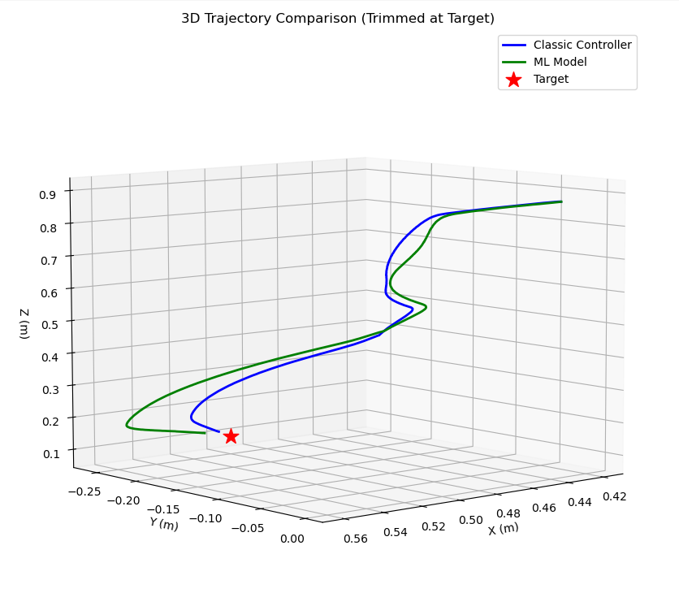
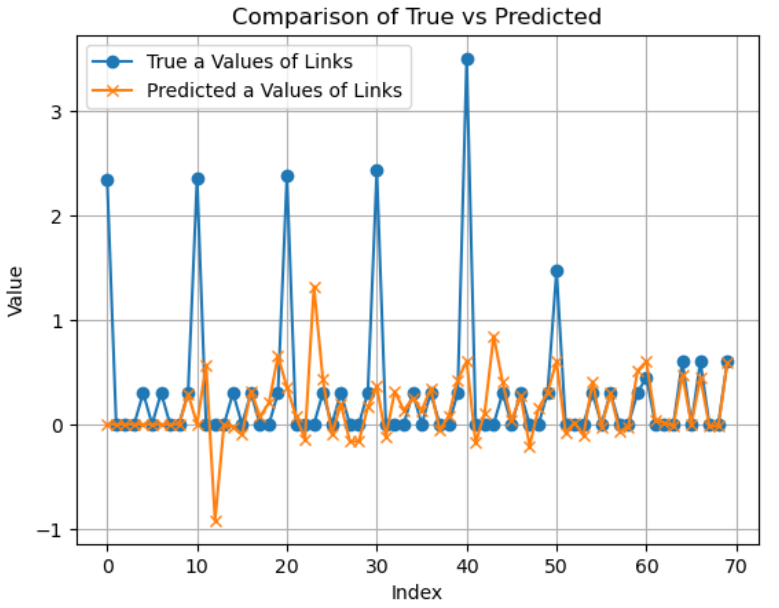
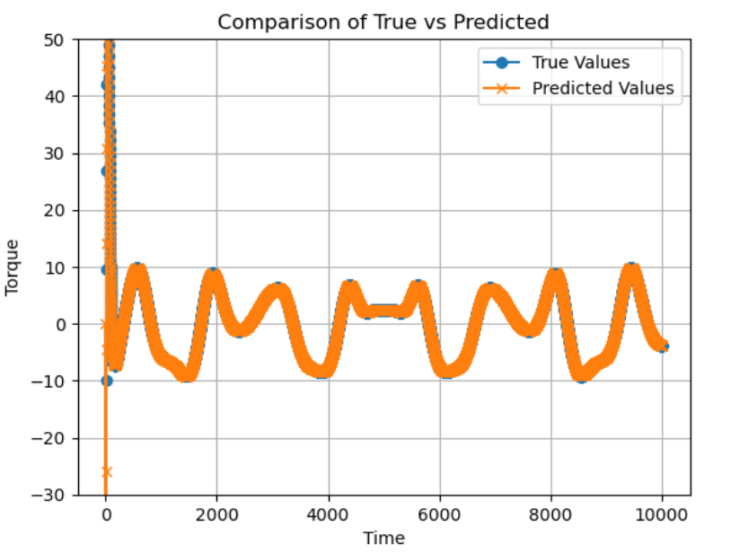
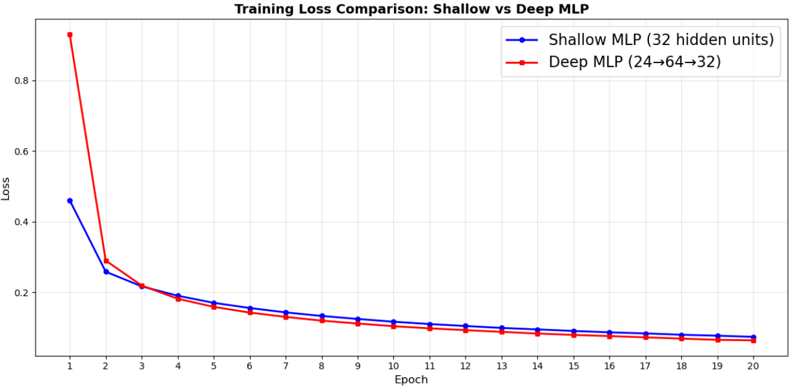
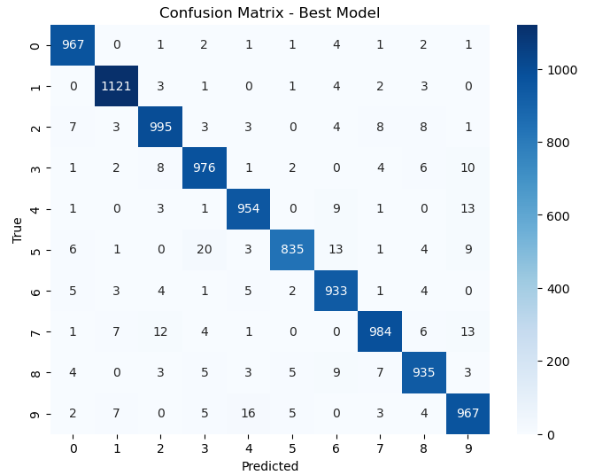
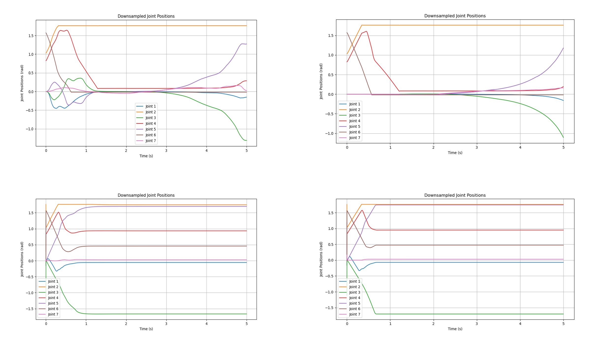

# Machine Learning for a Simulated Franka Panda

This repository contains the code for three pieces of work on machine learning for robotics, two of them on a simulated **Franka Emika Panda** arm in PyBullet:

* **Lab 1** estimates the dynamic parameters of the Panda by linear regression on simulated joint data, and predicts joint torques from them;
* **Lab 4** compares a shallow and a deep multilayer perceptron (MLP) on MNIST digit recognition and tunes batch size and learning rate;
* **the project** learns a reach controller: an MLP that predicts torque commands from joint errors, and an MLP and a random forest that replace the Cartesian differential-kinematics step of the controller.

The full write-up is in [report.pdf](./report.pdf). Developed for the UCL module *COMP0245: Machine Learning for Robotics* (2025).



## Repository structure

| Part | Code |
|---|---|
| Lab 1 — data collection in simulation | `lab_1/dynamic_regression.py` |
| Lab 1 — regression, F-statistic, R² and confidence intervals | `lab_1/calculate.ipynb` |
| Lab 4 — shallow and deep MLPs on MNIST | `lab_4/multilayer_perceptron.ipynb` |
| Project part 1 — data generation and the torque MLP | `project/part_1/` |
| Project part 2 — data generation, tuned MLP, random forest and closed-loop evaluation | `project/part_2/` |

* `project/*/rollout_loader.py` — loads the recorded trajectories;
* `project/part_2/best_mlp_tuned.pth`, `config.json`, `normalization_stats.npz` — the trained MLP, its hyperparameters and the input and output normalisation it was trained with;
* [figures](./figures/) — figures from the report;
* [report.pdf](./report.pdf) — the report.

## Built on

The simulation scripts run inside the course's lab framework, which provides the `simulation_and_control` package (PyBullet simulation, the Pinocchio-based `PinWrapper`, the feedback-linearisation controller and `CartesianDiffKin`) and the Panda configuration.

* [PyTorch](https://pytorch.org/) — the MLPs;
* [Ray Tune](https://docs.ray.io/en/latest/tune/) — the hyperparameter search of project part 2;
* [scikit-learn](https://scikit-learn.org/) — the random forest, grid search, scaling and metrics;
* [ultimate-utils](https://github.com/brando90/ultimate-utils) — the MNIST train and validation split of Lab 4;
* [NumPy](https://numpy.org/), [SciPy](https://scipy.org/), [Matplotlib](https://matplotlib.org/) and [seaborn](https://seaborn.pydata.org/).

## Method

**Lab 1.** The Panda follows a sinusoidal reference while the script records joint angles, velocities, accelerations and torques, and builds the dynamic regressor Y with Pinocchio, so that u = Y a. The parameters are estimated with the pseudoinverse, with no intercept, since a robot at rest needs no torque. Part 1 estimates only link 7, using the known parameters of links 1 to 6. Part 2 estimates all seven links at once. The fit is scored with the F-statistic, adjusted R² and 95% confidence intervals.

**Lab 4.** A shallow MLP (one hidden layer of 32 units, 25,450 parameters) and a deep MLP (24, 64 and 32 units, 22,850 parameters) are trained with SGD and a negative log-likelihood loss on normalised MNIST images. The shallow model is then trained with batch sizes of 16, 32 and 64 and learning rates of 0.005, 0.01 and 0.02, and the epoch with the lowest validation loss is kept.

**Project.** Targets are sampled in a half circle of about 0.8 m radius around the robot base, and 200 trajectories are recorded and split 70/30 into training and test sets.

* Part 1 trains an MLP with hidden layers of 128, 128 and 64 units to map the seven joint-angle errors to the seven torque commands.
* Part 2 predicts the next desired joint positions and velocities, 14 outputs, from the current joint positions and the Cartesian target. An MLP is tuned with Ray Tune over layer sizes, batch size, learning rate and epochs, and a random forest is tuned by 5-fold grid search over the number of trees, depth and features.
* The trained model then replaces `CartesianDiffKin` in the control loop, and its trajectories are compared with those of the classic controller.

## Results

| Lab 1 | Link 7 only | All links |
|---|---|---|
| F-statistic | 29,920 | 5,551 |
| Adjusted R² | 0.81 | 0.85 |

* **Lab 1.** With links 1 to 6 known, the link 7 parameters match the true values. Estimating all links at once leaves the stacked regressor with rank 43 of 70, so many parameters are wrong and only 51% of the true values fall inside the 95% intervals. The torque predictions stay accurate all the same, because a rank-deficient Y lets many parameter vectors give the same torques.
* **Lab 4.** The deep MLP starts with a higher loss but ends lower than the shallow one, with fewer parameters. The best shallow model, batch size 16 and learning rate 0.01, reaches 96.67% test accuracy. Most errors are between 4 and 9 and between 3 and 5.
* **Project part 1.** The torque MLP reaches an average R² of 0.75 across the seven joints. Adding joint-velocity errors as inputs raised it to 0.8–0.9.
* **Project part 2.** The tuned MLP has hidden layers of 64, 128 and 64 units, batch size 256 and learning rate 0.0018, and reaches an average R² of 0.994 on every output except the joint 7 velocity. That joint barely moves in the data, so its R² is undefined. The random forest, with 50 trees, depth 20 and square-root features, scores higher, with an R² of 0.9976 and an MSE of 0.0014.
* **Closed loop.** The MLP controller reaches the same final joint states as the classic controller and follows its path in 3D. The random forest is too slow to predict for real-time control, so the MLP is the controller of choice despite its lower score.

| | |
|---|---|
|  |  |
|  |  |



## Running

The simulation scripts need the course's lab framework and its `simulation_and_control` package. The project scripts import their loader from the framework's `final` package (`from final.rollout_loader import load_rollouts`), so they belong in that folder. The notebooks need only the Python packages:

```
pip install -r requirements.txt
```

* Lab 1: run `dynamic_regression.py` in the framework, then `calculate.ipynb` on the data it saves.
* Lab 4: the notebook downloads MNIST to `./data` and expects a copy of ultimate-utils in `./ultimate-utils-master`.
* Project part 1: `data_generator.py` saves each trajectory as `data_<i>.pkl` next to the script, and the notebook reads them from `origin_data/`. The script also opens `rf_model.pkl` and `mlp_model.pkl` and imports `final.dmlp` from the framework, which are not included here.
* Project part 2: `data_generator.py` saves the trajectories into `training_trajectories/` and `testing_trajectories/`, `tuned_model.ipynb` trains the models, and `model_eval.py` flies the learned controller in simulation next to the classic one.

The recorded trajectories are not included in this repository.

## Author

Amir Gerges, MSc Robotics and Artificial Intelligence, UCL.
